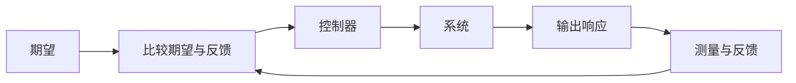
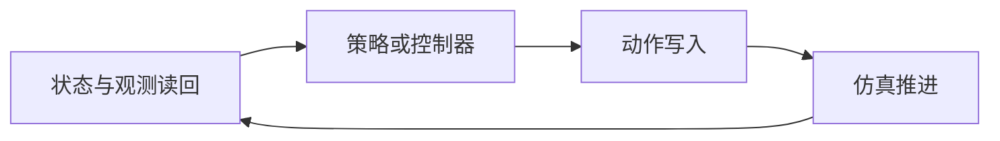
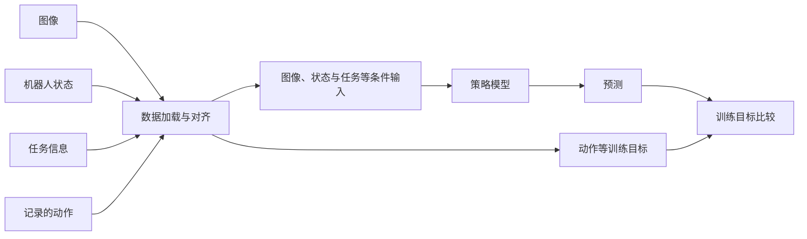
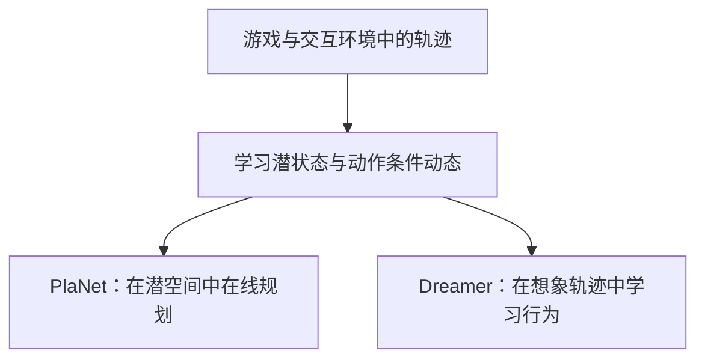
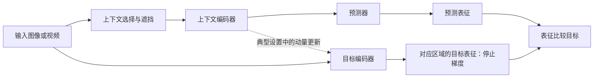

# 具身智能研究入门指南

**Embodied AI Research Starter Guide**

从基础课程走到数据、VLA、世界模型与论文写作，把学习路径放回具体问题。

**作者：林航宇** · 面向具身智能研究入门者的个人分享 · 公开整理：2026-10-29

[开始阅读](#intro) · [按方向选路线](#s01) · [课程推荐](#s02) · [数据与模型](#s07) · [论文写作](#part3) · [参与完善](CONTRIBUTING.md)

> 这份指南希望分享的，是从“找到资料、跑通代码”走向“理解问题、判断证据”的学习路径。课程是入口，模型是案例；沿着数据、信息流和真实结果追问，才逐渐形成自己的研究判断。

<a id="intro"></a>
## 写在前面

这份指南，也算是我对“让本科生回归本科生”的一点回应，同时写给希望进入具身智能研究的学习者。在AI让信息获取、代码编写和项目入门都变得更容易的今天，我仍然觉得，愿意参与科研的同学，值得先沉下心把基础理论学扎实，逐渐建立清楚、连贯的知识体系。本科阶段不必过早被论文、比赛和履历推着走；能留出时间认真学懂一门课、弄明白一个问题，本身就是很重要的积累。

工具可以更快地给出答案，却不能替我们判断答案是否可靠。代码能运行，不代表我们理解了它；能复述模型名字，也不代表知道它为什么有效。线性代数、概率、优化、动力学和控制这些基础，最后都会出现在读论文、设计实验和排查问题的过程中。**学基础不是等到“全部准备好”才做研究，而是让学习与实践互相支撑，不把暂时跑通当作已经理解。**

MIT、斯坦福等学校有许多可以公开学习的优质课程，相关路线也已经整理得很充分，这里不再一一展开。课程之外，各种视频平台、技术社区和个人博客上同样有大量教程，只是质量参差不齐。获得信息已经不难，真正花时间的是筛选：哪些讲解准确，哪些能形成完整知识链，哪些适合自己当前的基础，哪些又只是看起来很热闹。

就我自己的学习体验而言，B站上经过认真筛选的中文系列课，在讲解的连贯性、细节和入门友好度上，整体比我在YouTube上找到的同类教程更合适，教学质量也常常更让我满意。这是个人的使用感受，并不是给两个平台上的所有内容排高低。因此，这份清单以国内较容易获取、对中文学习者友好的教程为主，希望替刚入门的同学省下一些四处寻找和反复试看的时间。

基础课程的主推荐，都是我完整看过、其中一些还反复回看过的系列。我更愿意把自己走过的路上确实有帮助的内容拿出来，而不是堆一长串听说过的名字。“推荐看完”指选定的一套基础主线，不是刷完一位老师或UP主的全部视频。后面补充的官方文档、英文课程、论文与实验室入口，作为延伸资料；我没有系统学过的部分会保留说明，不把资料索引写成亲身经历。

具身智能与机器人是一套很大的知识体系，分支也很多。这份指南更接近我自己的学习路径，并不覆盖整个领域。许多计算机视觉细分方向、SLAM、灵巧手、智能驾驶、无人机及相关运控，以及面向交叉研究的基础设施（Infra），我还没有系统涉猎，仍有很多需要学习。大家完全可以按方向取舍，也欢迎把自己学过、做过、真正觉得好的资料补进来。

到了VLA和世界模型部分，我尤其建议把数据与架构连着看：一条演示怎样变成训练样本，图像怎样变成token，张量的形状和语义怎样变化，条件从哪里进入，损失更新了谁，最后的动作又怎样落到机器人上。沿着这条链走一遍，往往比多记几个缩写更有收获。写下这些内容，是希望大家不必急着追完所有新模型，只希望能帮助大家少绕一点路，把一个问题真正弄懂。

<a id="contents"></a>
## 目录与使用方法

| 你现在的情况 | 建议从哪里开始 |
|---|---|
| 刚接触科研，资料很多却不知道怎么学 | [第一部分：学习、工具与判断](#part1)，先选一个问题和一个小目标。 |
| 已有编程基础，准备进入具身智能 | [第二部分](#part2)先选方向，再按需补课程，不必全部学完才动手。 |
| 准备读 VLA 或世界模型 | 先看[数据](#s07)，再看[架构](#s08)和[预测如何服务行动](#s09)。 |
| 正在读论文、组织实验或写作 | 看[精读路线](#paper-reading)、[实验习惯](#s10)和[第三部分：写作入门](#part3)。 |

- [第一部分：学习、工具与判断](#part1)
- [第二部分：具身入门与研究方向](#part2)
  - [01　先收藏几张地图，再选一条主线](#s01)
  - [02　编程与科研工具](#s02)
  - [03　机器人、嵌入式、Ubuntu、ROS 2 与控制](#s03)
  - [04　机器学习、深度学习与强化学习](#s04)
  - [05　仿真、几何与视觉](#s05)
  - [06　数学直觉与生成模型](#s06)
  - [07　VLA 先读数据：从一条 episode 开始](#s07)
  - [08　VLA 再读架构：跟着信息和张量走](#s08)
  - [09　世界模型：预测、数据与行动](#s09)
  - [10　实验习惯、算力与真机边界](#s10)
  - [11　长期关注少数研究源](#s12)
- [第三部分：写作入门](#part3)
  - [12　从读论文到写论文](#s11)
  - [摘要](#abstract)、[引言](#introduction)、[相关工作](#related-work)、[措辞与结论](#claims)
- [13　按方向选择的小作业](#s13)
- [14　常见术语与使用说明](#s14)
- [致谢、贡献与许可](#credits)

### 课程清单怎样使用

主推荐来自我自己的学习经历。“推荐看完”指选定的一套基础主线；没有系统学过的内容会明确说明。官方文档、英文课程、论文和团队入口是延伸资料，不一概当作亲身学习经历。

| 标签 | 建议的投入方式 |
|---|---|
| **推荐看完** | 选一套主线系统学，配合推导、代码或练习；不等于刷完作者全部内容。 |
| **视情况** | 按方向和当前基础补齐需要的部分。 |
| **跑通案例** | 先完成一个完整案例，建立接口与执行流程的认识，之后按需查文档。 |
| **依兴趣** | 用于拓宽视角、重拾直觉或跟进研究线，不作为统一前置要求。 |

全文中的形状表、可见性矩阵和教学图均会标明示例性质；具体配置回到对应论文与实现。点击目录可跳转，长章节末尾可返回目录。

<a id="part1"></a>
## 第一部分：学习、工具与判断

### 先把学习落到一个具体问题

初学时最容易把进度理解为“又收藏了一套课”“又装好了一个模型”。更有用的标尺是：我现在能解释哪个现象，能在代码里找到哪条关系，能通过什么小实验确认自己的理解？

基础与实践可以相互推进。学到坐标变换，就画清一次相机到机械臂的关系；学到损失函数，就看一批真实样本在约束什么；学到反馈，就改变一个控制参数观察响应。困惑会告诉我们下一门课该补哪里。

```text
遇到问题 → 提出自己的解释 → 查课程、论文与代码
       → 做一次小改动 → 观察结果 → 修正理解
```

这里最值得保留的是“提出自己的解释”这一步。先写下预期，再观察结果，才能分清是原有理解得到了支持，还是事后给现象找了一个听起来顺畅的说法。

### AI 能加快过程，判断仍需要自己形成

AI 可以辅助检索、解释公式、定位代码和处理重复工作。使用时，尽量给出具体材料和具体疑问：一条样本、一个函数、一张原图，通常比“把整个方向讲明白”更容易形成有用讨论。

我会把三件事分开：**材料明确写了什么、我怎样理解、还需要什么证据。** AI 给出一种解释时，回到原文或实现找到对应位置；解释预测了某种行为时，用一个小例子检查。顺畅的语言会降低阅读成本，证据决定解释能走多远。

一次好的讨论，不一定马上得到完整答案。能把“模型不懂指令”拆成“数据里指令是否影响正确行为、条件是否送入模型、评价是否区分目标选择和动作执行”，就已经把问题推进到了可以动手的位置。

### 从复现走向研究，先追一个值得解释的差别

跑通公开实现后，找一个稳定、具体的现象：换布局为什么变了？换指令是否改变选择？预测误差更低为什么未必改善控制？固定任务、数据和预算，先比较一个变化，再考虑方法设计。

讨论机制时，也要分清证据的含义：

| 做了什么 | 能直接说明什么 |
|---|---|
| 可视化特征、注意力或轨迹 | 展示表示与行为，帮助提出解释。 |
| 比较相似度或相关性 | 描述变量之间的关系。 |
| 改变输入、遮挡或扰动 | 测量模型对具体变化的敏感性；扰动是否符合任务分布也会影响解释。 |
| 控制条件下改变一个机制并比较后果 | 在明确干预、对照与假设范围内讨论机制作用。 |

**先问一个会改变下一步的问题。** 一个代表性实验把它回答清楚后，就进入下一阶段；需要增加实验时，说明新增实验将区分哪两种解释。

> **带着这个问题往下读：** 我能否从一条真实数据开始，说明模型看到了什么、学到了什么、为什么产生这个动作，以及结果支持了什么判断？

[返回目录](#contents)

<a id="part2"></a>
## 第二部分：具身入门与研究方向

前面讨论的学习方法，现在放进具身智能：课程建立基础，数据与模型连接实现，世界模型帮助思考预测与行动，长期研究源提供连续的问题脉络。

| 学习入口 | 先形成哪种认识 |
|---|---|
| 课程基础 | 编程、数学、机器人学与控制怎样支撑后面的实现。 |
| 数据与模型 | 一条演示怎样成为监督，模型的输入输出怎样接回机器人。 |
| 世界模型 | 预测什么、从什么数据学习、预测怎样改变行动。 |
| 长期研究源 | 一个问题怎样在连续工作中被重新定义和推进。 |


*SO-101 机械臂。图片来源见文末[素材来源](#media-sources)。*

> **我的当前基础，最需要补哪一块？**

<a id="s01"></a>
### 01　先收藏几张“地图”，再选一条主线

入门资料已经有不少很好的开源整理，没必要再造一份百科全书。下面这些更像地图，遇到新概念或需要找项目时回来查，不必四份都从头读完。

| 项目入口 | 我建议怎样用 |
|---|---|
| [Embodied-AI-Guide](https://github.com/TianxingChen/Embodied-AI-Guide) | 中文总览，覆盖算法、基础设施、控制、硬件和动手项目。先看目录，知道各个方向在解决什么，再按需要展开。 |
| [PKU EPIC Lab：embodied-ai-start](https://github.com/jiangranlv/embodied-ai-start) | 面向初学者的路线与实践入口，适合对照自己的背景，找出需要补的环节。 |
| [Datawhale：every-embodied](https://github.com/datawhalechina/every-embodied) | 中文动手学习资料。希望跟着代码理解具身模型的同学，可以选一条教程完整做下来。 |
| [Xbotics-Embodied-Guide](https://github.com/Xbotics-Embodied-AI-club/Xbotics-Embodied-Guide) | 作为课程、仿真与开源项目的补充索引，和前几份交叉查阅即可。 |

#### 不必所有人走同一条路

**偏操作／VLA：** Python与PyTorch → 机器人运动学和基本控制 → LeRobot数据与一个模仿学习策略 → 仿真闭环 → 预训练VLA适配。

**偏运控／强化学习：** Python／C++与控制 → 机器人动力学 → 强化学习 → Isaac Lab或选定仿真器 → 宇树等公开策略的训练、回放与适配。

**偏表征／世界模型：** PyTorch与深度学习 → 概率与生成模型 → PlaNet／Dreamer或JEPA → 一个小型行动条件预测任务 → 再进入视频—动作模型。

**偏硬件／系统：** C++、嵌入式、通信与控制优先，之后用ROS 2连接传感、执行和学习策略。硬件内容可以并行学习，不必成为所有算法实验的前置关卡。

我更建议“选一条能跑起来的主线，哪里不懂补哪里”。同时安装三套仿真器、下载五个大模型，往往只是把环境问题一起放大了。

**这一阶段可以做的事：** 选一个课程、一个项目和一个小目标，写下准备做到什么。比如“看懂并改动一次动作数据读取”，比“全面掌握具身智能”更容易开始。

[返回目录](#contents)

<a id="s02"></a>
### 02　编程与科研工具：先把日常工作做顺

MIT、Stanford、CMU 等高校有很好的公开课体系，可以先从 [MIT OpenCourseWare](https://ocw.mit.edu/)、[Stanford Online](https://online.stanford.edu/free-courses)、[CMU Open Learning Initiative](https://oli.cmu.edu/)了解课程入口；具体专题再回到授课教师或课程主页。这里主要展开我更熟悉的 B 站中文系列课。

我筛选课程时主要看三件事：**讲解准确、形成知识链、适合当前基础。** 连贯讲解能帮助我把定义、推导和代码接在一起；能否解释当前卡住的问题，比课程名字是否热门更重要。获得信息已经不难，真正花时间的是筛选。

#### Python／PyTorch：小土堆 · 推荐看完

[小土堆B站主页](https://space.bilibili.com/203989554/) ｜ [PyTorch入门教程](https://www.bilibili.com/video/BV1hE411t7RN/)

这一块我比较推荐小土堆。Python基础不足的话，先把函数、类、文件读写、包与环境弄清楚，再完整走一遍PyTorch入门，跟着写，不要只看。上面的主要课程入口是PyTorch课，不把它当作一套覆盖所有Python内容的教程。

第一阶段不必急着搭大模型。`Tensor`、`Dataset`、`DataLoader`、`nn.Module`、损失、反向传播和优化器，最好都能对应到自己写过的代码。再补一点NumPy、数组索引和广播，读机器人数据会轻松很多。

**建议做到：** 独立完成数据读取、训练、验证、保存与加载权重；能说明训练时更新了哪些参数，并能在几条样本上过拟合，检查模型和标签有没有接错。

#### C++：侯捷 · 视情况

[侯捷课程主页](https://boolan.com/jjhou)

C++不用一开始把所有高级内容吃透，但基本语法和标准库一定要清楚。我会优先看对象与类、指针和引用、对象生命周期、常用容器、迭代器，以及模板的基本用法。旧课程的细节要和项目采用的C++标准对照。

后面碰到ROS 2、驱动和控制器，至少要能读懂数据怎样传递、对象什么时候销毁。再按需要补智能指针、并发和CMake。不要一见到编译报错就重装系统，先分清是语法、链接、依赖版本还是运行时问题。

**建议做到：** 写一个小型读写程序，使用标准容器管理数据；会建立和编译一个简单工程，能用调试器查看调用栈。

```text
改输入或代码 → 看输出 → 对照概念 → 回到实现找到原因
```

> **输入改了，输出为什么变？我能在代码里找到对应位置吗？**

#### 科研工具：建议补一遍Missing Semester

[Missing Semester中文版](https://missing-semester-cn.github.io/) ｜ [原课程](https://missing.csail.mit.edu/) ｜ [Git官方书籍中文版](https://git-scm.com/book/zh/v2)

这部分很容易被忽略，却直接影响每天做事的效率。我建议至少用顺Git、SSH／tmux、终端检索、环境管理、日志和断点调试。远程训练一断网就得重跑、代码改完找不到昨天的版本，这些问题比“不会某个最新模型”更早妨碍研究。

每次重要实验留下代码版本、配置、数据范围、权重来源和输出目录。环境文件不必写得复杂，但应该能回答“这次到底装了什么”。只留一个名叫`final_best_v3.pt`的文件，几周后往往连自己都说不清。

AI coding可以帮助读代码、补测试和做重复工作，但我会要求自己看懂输入输出、关键条件和结果依据。**脚本正常退出，只能说明没有在这条路径上报错，不代表模型已经做对。** 生成的新代码先在小数据上检查，再提交长作业；也别让多个agent同时修改同一个核心文件。

[返回目录](#contents)

<a id="s03"></a>
### 03　机器人、嵌入式、Ubuntu、ROS 2与控制

#### 机器人学：台湾大学林沛群 · 推荐看完

[台大开放课程《机器人学一》](https://ocw.aca.ntu.edu.tw/courses/mooc0031) ｜ [B站运动学](https://www.bilibili.com/video/BV1v4411H7ez/) ｜ [B站动力学](https://www.bilibili.com/video/BV1Vt41157jp/)

机器人学这一块，我推荐林沛群老师。运动学、动力学等基础建议系统过一遍。台大官方《机器人学一》主要讲空间运动描述、顺逆运动学和轨迹规划，动力学需要继续看对应课程，不是一门短课就把全部内容讲完。

哪怕以后主要做神经网络，也应该知道坐标变换、末端位姿、关节变量和雅可比在解决什么问题。**模型输出一串数字以后，机器人究竟怎样动起来，这部分不能始终是黑箱。**

李群、李代数我没有系统学过，这里先不随便指定一门课。遇到姿态优化和状态估计时再有针对性地补；至少先把旋转矩阵、四元数、坐标系和左右乘的含义分清。

> **关节角与末端位置怎样联系？** 把坐标系、正逆运动学和轨迹规划放到同一条动作链上理解。

#### 嵌入式：江科协／江协科技 · 推荐看完

[江协科技官网](https://jiangxiekeji.com/)

也就是以前常说的江科协、江科大自化协。我比较推荐跟着STM32基础课做一遍，把GPIO、中断、定时器、PWM、串口和常用通信接口摸清楚。

做算法的同学不必因此转去设计复杂板卡，但最好能判断传感器有没有在发数据、电机命令送到了哪里、控制周期是否符合预期。学一段就连一个外设，印象会比只记寄存器名字深。

> **软件指令怎样变成真实硬件响应？** 沿通信、硬件接口和实际反馈追一次命令。

#### Ubuntu：鱼香 ROS／机器人工匠阿杰 · 推荐看完

[鱼香ROS](https://fishros.com/) ｜ [机器人工匠阿杰：Ubuntu安装教程](https://www.bilibili.com/video/BV1554y1n7zv/)

Ubuntu不只是装好双系统。目录、权限、环境变量、软件安装、进程和终端这些日常操作，建议一开始花时间弄熟。安装教程可以跟着学，版本不能机械照搬：先看机器人驱动、ROS 2、CUDA和仿真器需要什么环境，动分区之前做好备份。

遇到问题先区分系统、驱动、Python环境和项目依赖。新项目尽量独立环境；能够复用同一驱动，不代表所有项目都该塞进同一个conda环境。

#### ROS 2：鱼香 ROS，Python 与 C++ 都学 · 推荐看完

[《动手学ROS 2》与代码目录](https://gitee.com/fishros/d2l-ros2) ｜ [B站配套课程](https://www.bilibili.com/video/BV1gr4y1Q7j5/) ｜ [ROS 2官方文档](https://docs.ros.org/)

ROS 2我建议两种语言都学，不一定同时学到很深，但基本节点和通信例子都动手写一遍。先把话题、服务、动作、参数这几块弄明白，再学launch、TF、URDF、RViz、Gazebo和`ros2_control`。习惯上有人统称“四种通信”，其中参数更接近节点配置及其访问机制，实际用途不要混淆。

| 机制 | 入门时对应一个具体问题 |
|---|---|
| Topic／话题 | 相机、关节状态等持续数据怎样发布和订阅？ |
| Service／服务 | 一次明确请求怎样取得一次响应？ |
| Action／动作 | 长任务怎样返回进度、取消或判断完成？ |
| Parameter／参数 | 节点配置怎样声明、读取与更新？ |

基础之后值得补QoS和时间戳：能收到消息，不代表收到的是足够新的消息。ROS 2是软件基础设施，不是智能算法；把感知、模型、规划和控制组织清楚，比背命令重要。

#### MoveIt 2：官方案例 · 跑通案例

[MoveIt 2教程](https://moveit.picknik.ai/main/index.html) ｜ [ros2_control文档](https://control.ros.org/)

先跑通一个机械臂规划例子，看明白机器人描述、规划场景、碰撞检查、轨迹和控制器怎样接起来，再按需要查。规划成功、轨迹发送成功和机器人实际到位，是三个不同结果，日志里最好能分别看见。

> **谁发、谁收、何时结束、参数改了什么？规划和执行的配置、代码分别在哪里？**

#### 控制理论：DR_CAN 与《控制之美》· 推荐看完；卢京潮 · 视情况

[DR_CAN B站主页](https://space.bilibili.com/230105574/) ｜ [卢京潮《自动控制原理》](https://www.bilibili.com/video/BV1f64y187LR/)

DR_CAN的基础控制系列，我推荐完整看，也可以配《控制之美》系列学习。先把传递函数、时域响应、频域、稳定性和状态空间连起来，再按方向深入最优控制、MPC和卡尔曼滤波。卢京潮老师的课适合补定义、推导和基础题。

学控制时，我会反复问：反馈纠正什么，延迟影响什么，为什么参数一调系统就振荡。学习策略可以输出参考动作，但高频跟踪、接触稳定和保护仍需要认真设计，不是有了大模型就不需要控制。



这个反馈图用于连接公式与系统表现：传递函数或状态方程描述系统怎样变化，控制器根据偏差调整输入。改变增益、延迟或扰动，再看超调、振荡、稳定时间怎样变化，公式就有了可以对应的现象。

> **公式怎样描述系统？为什么引入反馈？响应会怎样变化？**

[返回目录](#contents)

<a id="s04"></a>
### 04　机器学习、深度学习与强化学习

#### 机器学习：吴恩达 · 推荐看完

[Machine Learning Specialization](https://www.coursera.org/specializations/machine-learning-introduction)

可以作为第一条机器学习主线，选择适合的字幕版本即可。它不是中文授课，但适合放在中文友好的学习路线中。

重点不只是记住几个算法，而是弄清监督信号、损失、优化、过拟合和泛化的关系。训练集、验证集、测试集各自能做什么，这些习惯越早建立越好。

#### 深度学习：李沐、李宏毅 · 推荐看完

[《动手学深度学习》中文版](https://zh.d2l.ai/) ｜ [李沐B站](https://space.bilibili.com/1567748478/) ｜ [李宏毅课程主页](https://speech.ee.ntu.edu.tw/~hylee/) ｜ [中文配套整理](https://github.com/datawhalechina/leedl-tutorial)

李沐的《动手学深度学习》适合跟着代码完整走，建立读模型、改模型和检查训练的能力；论文精读适合之后学习别人怎样提出问题、安排对照。李宏毅老师的基础课程也推荐完整看，用来建立概念之间的联系，再补生成式AI等专题。

两位老师可以互补，但不必把同样的章节连续刷两遍。一个概念能自己推一点、写一点、解释一点，比“看过”更可靠。可以选一位作为主线，另一位补卡住的部分。

读新方法时，可以把变化分到三个位置：**结构**决定信息怎样计算，**目标**决定什么预测受到奖励或惩罚，**训练方式**决定数据和参数怎样被组织。三个位置可能同时变化，比较时分别看清。

> **模型在拟合什么？损失在约束什么？为什么区分训练和测试？**

#### 强化学习：赵世钰 · 推荐看完

[课程与资料说明](https://www.bilibili.com/opus/709028860846407685) ｜ [配套书稿与代码](https://github.com/MathFoundationRL/Book-Mathmatical-Foundation-of-Reinforcement-Learning)

先把MDP、回报、价值函数、Bellman方程、策略梯度和Actor–Critic理清楚，不要一上来只会调PPO参数。观测不等于完整状态，奖励也不等于成功判据；这些区别在机器人任务里很快就会遇到。

动手可以从[panda-gym](https://github.com/qgallouedec/panda-gym)开始。它基于PyBullet与Gymnasium，适合用小型机械臂任务理解观测、动作、奖励和终止。先训练一个到达任务，再只修改一个奖励或观测，看看行为为什么变了。

有了基础，可以用宇树的[unitree_rl_lab](https://github.com/unitreerobotics/unitree_rl_lab)练手。先完成仿真训练、加载和回放，理解域随机化与部署接口。不要把官方策略能跑，等同于自己的硬件可以直接上电执行；关节顺序、零位、归一化和周期都要核对。

> **实践时先追清仿真闭环：动作写入 → 仿真推进 → 状态读回。** 当前观测来自哪一步？奖励和终止在哪一步计算？

**延伸课程：** [Berkeley CS285](https://rail.eecs.berkeley.edu/deeprlcourse/)适合之后把模型式学习、离线RL等方向串起来。先有一门系统基础，再看进阶，不必一开始同时追多套课程。

[返回目录](#contents)

<a id="s05"></a>
### 05　仿真、几何与视觉：把接口接明白

#### Isaac Lab：中文教程配官方文档 · 推荐看完

[B站UP主 IsaacLab](https://space.bilibili.com/2068165497/) ｜ [Isaac Lab官方文档](https://isaac-sim.github.io/IsaacLab/main/index.html)

同名B站UP主是非官方中文教程，与NVIDIA官方项目分开看。中文视频适合把流程理顺，具体API和版本问题回文档查。Isaac Lab是在Isaac Sim之上组织机器人学习任务的框架。

入门阶段先学会创建场景，载入机器人和物体，配置传感器、观测、动作、奖励与重置。之后亲手改一个观测或奖励，再检查输出。仿真循环至少要能用自己的话讲清楚：

```text
读取当前观测 → 策略／控制器产生动作 → 下发控制
→ 推进若干物理子步 → 更新传感器与状态
→ 计算结果、奖励和终止 → 必要时重置
```



> **这次动作改的是目标位置、速度还是力矩？推进了几个物理步？下一次读回的状态对应哪个时刻？**

还要区分物理步长、控制频率、策略调用频率和渲染频率。它们可以不同。录像写着30fps，不代表模型每秒推理30次；推理期间暂停物理，也不能当作真实异步控制。

#### MuJoCo与OpenCV：先放官方入口，不随便推荐整套课

[MuJoCo文档](https://mujoco.readthedocs.io/) ｜ [OpenCV文档](https://docs.opencv.org/)

这两部分我没有系统跟过一套完整课程，先不点名推荐UP主。MuJoCo实际用到时，可以从模型文件、状态、控制输入、接触与步进查起；OpenCV则围绕图像读写、颜色空间、标定和几何变换补。

能调用检测模型，和能把结果正确交给机器人，是两个环节。模拟器知道物体精确位姿，不代表你的相机策略也能读取它；模型学会了某个动作，也不代表另一个机器人接口有同样含义。

#### 几何与时间同步，值得专门做一个小实验

用已知物体检查一次“图像／相机坐标 → 机器人基座 → 末端目标”的变换。明确四元数顺序、旋转约定、米与毫米；固定相机和眼在手相机，也不是同一种外参关系。

记录图像采集、状态采集、命令发送和执行时刻。相机有延迟时，把旧图像和当前关节状态直接拼起来，可能得到一组现实中从未同时出现的观测。

作为后续查阅材料，可以看[MIT Robotic Manipulation](https://manipulation.csail.mit.edu/)与[Modern Robotics](https://modernrobotics.northwestern.edu/)。这里将它们列为延伸资料，不改成“我已经系统学过”的推荐。

[返回目录](#contents)

<a id="s06"></a>
### 06　数学直觉与生成模型：结构、目标和采样分开看

#### 数学直觉：3Blue1Brown · 推荐看完；漫士沉思录 · 依兴趣

[3Blue1Brown中文官方B站](https://space.bilibili.com/88461692/) ｜ [线性代数](https://www.3blue1brown.com/topics/linear-algebra) ｜ [微分方程](https://www.3blue1brown.com/topics/differential-equations) ｜ [漫士沉思录](https://space.bilibili.com/266765166/)

**强推3Blue1Brown的线性代数和微分方程。** 以前学过但一直在记公式，也适合回头看。理解矩阵怎样改变空间、微分方程怎样描述变化，后面读控制、优化和生成模型都会更有画面。

漫士沉思录可以按兴趣看，作为重拾数学、换一种视角理解问题的补充。可视化能帮助直觉，但不替代自己的推导和计算。

> **这个公式在空间、图像或动态过程中，对应什么？** 矩阵运算可以对应空间变换，ODE 可以对应随时间展开的动态过程。

#### 模型基础：Diffusion、Flow Matching、VAE 与 ViT

[VictorYuki B站](https://space.bilibili.com/13355688/) ｜ [MIT Flow Matching and Diffusion Models](https://diffusion.csail.mit.edu/2026/) ｜ [DiT代码](https://github.com/facebookresearch/DiT)

扩散模型可以先看VictorYuki的系列，基础推导建议完整跟下来。再用MIT的课程、讲义和lab，把ODE／SDE、Flow Matching、score、条件生成以及网络结构连起来。VAE、ViT也要配前面的深度学习课程与原论文补，不把所有主题都算到一个视频系列里。

| 学习主题 | 建议抓住的核心 |
|---|---|
| Diffusion · VictorYuki · 推荐看完基础推导 | 加噪过程、预测量和去噪过程怎样对应；每一步损失在约束什么。 |
| Flow Matching · 视情况补系统课程 | 如何定义概率路径和速度场，训练目标怎样连接到积分采样。 |
| VAE · 视情况补基础 | 潜变量、变分推断、ELBO、KL 与重参数化怎样连起来。 |
| ViT · 视情况补基础 | 图像怎样切成 patch、变成序列，位置与注意力怎样进入表示。 |

推导和直观理解一起补：能跟一遍公式，也能用图或小例子讲清它在做什么。遇到变分目标，先补必要的概率与变分基础，再回到模型。

> **目标函数各项做什么？生成过程怎样组织？图像怎样变成序列？**

| 要分清的层次 | 例子 | 读论文时的问题 |
|---|---|---|
| 表示／压缩 | VAE、视觉特征编码 | 网络预测的是原始像素，还是某种潜表示？ |
| 网络骨干 | CNN、U-Net、Transformer、DiT | 一次前向怎样组织空间、时间和条件？ |
| 学习目标 | 噪声预测、干净样本预测、Flow Matching | 输出究竟在拟合什么，损失作用在哪里？ |
| 采样／积分 | 多步去噪、ODE求解、少步蒸馏 | 生成一次要调用网络几次，精度与代价怎样变？ |

VAE至少弄清潜变量、KL、ELBO与重参数化；注意力弄清Q/K/V、位置编码、mask与跨注意力；DiT再看生成阶段如何通过AdaLN等机制进入各层。**归一化后的可学习缩放，不是逐样本恢复原输入；动作反归一化回到米和弧度，又是另一件事。**

#### 网络深度、数据时间、生成进度是三根轴

```text
一段动作：Ta个真实控制时刻
一次预测网络：L个Transformer／U-Net层
一次生成：重复调用网络K次，再得到动作块
```

不能把“网络第十层”当成“去噪第十步”，也不能把生成了16个动作点，当成机器人实际重新观察了16次。固定`seed=0`仍可抽到高斯噪声；ACT中某个VAE潜变量取零，也不是扩散策略都从全零动作开始。

从结构看，U-Net用下采样、上采样和跳跃连接组织多分辨率；原始DiT主要在相同token网格中用注意力交换信息。时间U-Net可沿动作序列轴做多尺度处理。GRU、线性注意力、Mamba则值得在历史维护、流式输入和成本受限时比较，别一开始就替换整个预训练骨干。

延伸：[Flow Matching原论文](https://arxiv.org/abs/2210.02747) ｜ [Diffusion Meets Flow Matching](https://diffusionflow.github.io/) ｜ [Mamba](https://github.com/state-spaces/mamba) ｜ [FlashAttention](https://github.com/Dao-AILab/flash-attention)

[返回目录](#contents)

<a id="s07"></a>
### 07　VLA先读数据：从一条episode开始

#### 工程主线：LeRobot，之后再深入openpi

[LeRobot代码](https://github.com/huggingface/lerobot) ｜ [文档](https://huggingface.co/docs/lerobot) ｜ [机器人课程](https://huggingface.co/learn/robotics-course) ｜ [openpi](https://github.com/Physical-Intelligence/openpi)

我建议先用LeRobot建立完整工程认识：一条episode怎样保存，多相机、本体和动作怎样对齐，训练怎样读取样本，推理输出怎样交给机器人。对π系列有兴趣，再深入openpi。先抓数据变换、模型前向、损失、采样和部署几个入口，不需要读完仓库的每个文件。

#### 先画清四类信息，再追踪它们进入哪里



这是行为克隆的教学图。模型可以采用不同状态编码和动作表示；生成式策略还会把加噪动作等中间变量送入网络，需要回到具体训练路径查看。

> **这些数据分别放在哪里，加载后实际送到了模型哪里？**

#### 不只下载数据，要看它是怎样被构造出来的

[LeRobotDataset格式说明](https://huggingface.co/docs/lerobot/lerobot-dataset-v3) ｜ [Open X-Embodiment格式与代码](https://github.com/google-deepmind/open_x_embodiment)

LeRobotDataset v3把低维序列、视频与元信息分开组织，回合边界通过元信息定位；并不是“一段episode一定对应一个文件”。RLDS等格式也强调episode与step。文件后缀不是重点，**对应关系能否完整还原才是重点**。

| 一条演示至少要看清 | 为什么重要 |
|---|---|
| 图像与相机身份、内外参、采集时间 | 相同像素位置不一定对应相同空间位置；多路相机也未必完全同步。 |
| 本体状态 | 关节角、末端位姿、速度、夹爪开度分别有什么含义？是否经过滤波或归一化？ |
| 实际发送的动作 | 是关节目标、末端增量还是速度？坐标系、单位、控制周期和夹爪定义是什么？ |
| 指令与反馈 | 是整段任务、当前子目标，还是后来收到的纠正？何时真正可见？ |
| 回合边界、终止原因与有效mask | 提前结束或未执行的尾部，不能当成真实未来。 |
| 来源与划分 | 哪个操作者、场景、物体、策略或生成器产生的？哪些后代必须同组划分？ |

我会先手工看几条成功和失败记录，把动作曲线和视频同步放出来。若一条数据自己都无法解释，直接混进几十万条也不会自动变得正确。

#### 几个数据与基准入口，学习重点不同

| 入口 | 推荐关注的问题 |
|---|---|
| [LIBERO](https://github.com/Lifelong-Robot-Learning/LIBERO) | 任务语言、场景资产、示范与评测怎样对应；不同任务集到底在比较什么。 |
| [RoboTwin](https://github.com/RoboTwin-Platform/RoboTwin)／[项目页](https://robotwin-platform.github.io/) | 怎样从任务与资产生成动作示范，随机化覆盖了哪些视觉、语言和物理变化；拒收无效轨迹的条件是什么。 |
| [DROID](https://droid-dataset.github.io/)／[数据说明](https://droid-dataset.github.io/droid/the-droid-dataset) | 分布式真机采集怎样统一硬件、记录场景与动作；原始数据和训练格式各保留了什么。 |
| [Open X-Embodiment](https://robotics-transformer-x.github.io/) | 多本体数据怎样映射到可共同训练的格式；统一维度不等于统一物理含义。 |
| [UMI](https://umi-gripper.github.io/) | 手持示教怎样转为机器人可用监督；采集接口、相对动作表示、时间与部署之间怎样配合。 |

LIBERO／RoboTwin是环境与评测的一部分；DROID／OXE偏向可用于训练的数据资源；UMI是采集与策略接口。不是把它们全部叫“数据集”就可以互换。

#### 数据多样性要和问题对应

需要语言控制时，就要有**相近场景、不同有效要求、不同正确行为**的样本；所有画面一出现就唯一决定动作，模型可能没有理由认真读语言。需要修订能力，就应记录纠正之前、反馈到达和正确续接，而不只保留最后的成功画面。

想从失败中学习，先分用途。失败和恢复可以训练后果或价值；不符合要求的动作不能无条件当成专家行为模仿。普通视频没有同步机器人动作时，能提供时空先验，但不能直接当作同等质量的动作标签。

**这一章的作业：** 画出“原始轨迹 → 处理器 → 训练窗口 → batch → 动作目标”的流程，列出每步删掉了什么、补了什么、用了哪套统计量。这个工作比先改网络更值得优先做。

[返回目录](#contents)

<a id="s08"></a>
### 08　VLA再读架构：跟着信息和张量走一遍

#### 模型阅读顺序：ACT → Diffusion Policy → OpenVLA → π 系列

这是建立理解的建议顺序：先看动作分块与条件生成，再看视觉语言预训练怎样进入动作学习。**π 系列作为全面学习的主线**，逐篇比较数据、目标、架构与部署；SmolVLA、LingBot-VLA 用于补充和对照阅读。

> **前一篇留下什么困难，后一篇为什么这样改？** 阅读顺序帮助建立问题联系；每篇真正回应了哪项前作，仍以论文表述为准。

| 模型／系列 | 我建议重点看什么 |
|---|---|
| [ACT](https://github.com/tonyzhaozh/act) | 动作分块、Transformer、条件VAE。适合建立视觉模仿学习认识。 |
| [Diffusion Policy](https://diffusion-policy.cs.columbia.edu/)／[代码](https://github.com/real-stanford/diffusion_policy) | 用条件生成表示动作块，观察窗口、预测时域和实际执行长度怎样区分。 |
| [OpenVLA](https://github.com/openvla/openvla) | 视觉语言预训练怎样连接动作token，动作离散化与后续适配有什么代价。 |
| [SmolVLA](https://huggingface.co/docs/lerobot/smolvla) | 小型视觉语言骨干、动作专家与计算压缩，适合与较大VLA做结构对照。 |
| [π系列](https://www.pi.website/research)／[openpi](https://github.com/Physical-Intelligence/openpi) | 推荐连着学：数据配方、连续与离散动作监督、条件可见性、历史与执行机制。不同版本分开看。 |
| [LingBot-VLA](https://github.com/Robbyant/lingbot-vla) | 大规模数据、后训练和本体适配怎样进入可部署策略。技术报告、权重与代码范围需要对应。 |

ACT、原始Diffusion Policy是动作学习基础，不因使用图像就自动成为VLA；“VLA”也不是所有机器人智能方法的统一名称。

看完表格，可以打开 [π0 连续操作与官方演示](https://www.pi.website/blog/pi0)。观察机器人何时重新感知、何时执行动作块、遇到接触怎样继续，再把视频里的行为对应回论文和代码。

#### 模块名字只是起点

视觉可看[DINOv2](https://github.com/facebookresearch/dinov2)与[DINOv3](https://github.com/facebookresearch/dinov3)、[SigLIP相关官方实现](https://github.com/google-research/big_vision)；文本编码看[T5](https://github.com/google-research/text-to-text-transfer-transformer)；视觉语言基座可看[Gemma／PaliGemma](https://ai.google.dev/gemma/docs)。

DINO系主要提供视觉表示，SigLIP系学习图文对齐；T5文本条件与语言基座不是每个模型都必须一起堆上。DINO与Grounding DINO也不是同一项模型。下载权重之前先确认它在当前架构中承担什么角色、输出什么张量。

| 模块位置 | 可参考的代表 | 这一块负责什么 |
|---|---|---|
| 视觉 | DINO、SigLIP | 形成视觉表示；训练目标与适用接口各有差别。 |
| 语言与条件 | T5、Gemma | 编码文本或在语言模型中组织条件。 |
| 动作 | 回归头、生成式动作专家 | 在条件下输出动作或动作生成过程需要的量。 |
| 训练目标 | Flow Matching 等 | 规定网络拟合什么，例如给定路径上的速度。 |
| 网络架构 | DiT 等 | 规定信息怎样经过网络；可以承载相应生成目标。 |

例如，PaliGemma 中有明确的 SigLIP 视觉编码器与 Gemma 语言模型组合关系，可在 [PaliGemma 资料](https://ai.google.dev/gemma/docs/paligemma)继续追踪。DINO 与 T5 是旁支参考，不把它们画成所有 VLA 都必须串联的零件。**Flow Matching 是学习目标的一类，DiT 是网络架构；两者可以配合使用。**

> **这一块负责什么、怎样学习、输出交给谁？**

#### 一份便于读代码的形状示例

下面是**教学示例，不是π、FastWAM或其他模型的官方配置**。约定：批量B=2、相机数Nc=2、单帧224×224、patch边长16、文本padding到24个token、状态8维；公共隐藏宽度D=1024，预测16步7维动作。

| 环节 | 示例张量形状 | 信息发生了什么变化 |
|---|---|---|
| 相机输入 | `[2, 2, 3, 224, 224]` | 保留batch、相机、颜色通道和空间轴。 |
| 逐相机patch编码 | `[2, 2, 196, 768]` | 224/16=14，因此每图196个patch；此例不含CLS等额外token。 |
| 投影并合并相机token | `[2, 392, 1024]` | 通道宽度改变；应保留相机身份与位置信息。 |
| 文本嵌入 | `[2, 24, 1024]` | token ID变为向量；padding位置不能当真实文本。 |
| 本体状态投影 | `[2, 1, 1024]` | 8维状态编码成一个token；这一步不是逆运动学。 |
| 一个可选的拼接上下文 | `[2, 417, 1024]` | 392+24+1。其他模型可分支读取，不必全部拼接。 |
| 带噪动作及动作嵌入 | `[2, 16, 7] → [2, 16, 1024]` | 实数动作变为生成网络可以处理的token。 |
| 动作读取上下文 | 注意力分数可为`[2, h, 16, 417]` | h是注意力头数；哪些条件可见由mask决定。 |
| 输出与反归一化 | `[2, 16, 7]` | 预测噪声／速度经采样得到动作，再还原控制单位。 |

加入To帧历史后，应明确相机与时间轴，例如先保留`[B, To, Nc, Nv, D]`，再决定如何组织。像素shuffle、patch merging或resampler会改变token数，**不能看到224分辨率就假设所有模型都有196个视觉token**。

#### 三种常见连接方式，不预设谁更高级

```text
分塔／分专家：图像与文字先编码 → 融合表示 → 独立动作专家
跨注意力：动作token作为查询 → 读取视觉、语言和状态条件
统一序列：不同模态token进入共享网络 → 用mask规定可见关系
```

MoT可让不同模态保留自己的参数、在注意力中交换信息；它不一定是稀疏路由的MoE。“完全端到端”也要继续问：哪些参数真的被训练，哪些仍然冻结，哪些输入只在训练中存在？

动作输出至少有两条路线：离散token通过分类／自回归生成；连续动作通过回归、Diffusion或Flow Matching生成。连续动作专家内部可以是完整的DiT，不只是末端那层7维线性投影。训练与推理还可能使用不同的动作表示，不能按名字一刀切。

这三种描述观察的是不同维度：分塔／分专家强调参数与模块划分，统一序列强调 token 组织，交叉注意力强调读写方式。一个模型可以同时具有其中多种特征。

> **图像在哪里编码，语言在哪里加入，动作能用到什么？**

#### 可见性与端到端训练，要分开检查

下面是**示意矩阵，不对应任何特定模型配置**。行表示正在计算的查询，列表示它能读取的键／值；“✓”为可见，“—”为不可见，“过去”表示受因果限制。

| 查询 \ 键／值 | 当前合法观测与任务 | 动作生成 token | 真实未来标签 |
|---|---|---|---|
| 上下文 token | ✓，内部关系按实现设定 | — | — |
| 动作生成 token | ✓ | ✓，或按方法施加约束 | — |
| 时间序列中的历史 token | 过去 | 过去（若作为输入） | — |

真实未来可以进入监督或加噪目标；它是否以某种形式成为训练输入，需要结合目标设计检查。关键是推理时的预测不能读取届时不可获得的答案。掩码还需要结合 token 排列、时间步与缓存规则一起看。

| 参数范围 | 一个“冻结骨干、训练动作专家”的教学示例 |
|---|---|
| 视觉／语言骨干 | 冻结。 |
| 条件投影与动作专家 | 更新，具体范围需查训练配置和参数梯度。 |
| 端到端联合训练的另一种设置 | 部分或全部骨干也参与更新；连接在同一张图上不等于所有参数都更新。 |

> **谁能读到谁？训练时可用的信息，推理时还可用吗？哪些参数真的一起更新？**

#### 读一个仓库，我会追这五个位置

**数据处理器 → 编码器与投影 → 注意力可见性 → 损失与梯度 → 采样和执行。** 每个位置记下输入输出shape、单位、mask、dtype和设备，特别留意reshape／permute是否改变了真实语义。

推理常常只执行预测动作块的前几步，再观察和重规划。没有执行的尾部不是实际动作；动作块排队期间环境仍会变化。异步推理可看[LeRobot异步执行](https://huggingface.co/docs/lerobot/async)与[RTC原始研究](https://www.pi.website/research/real_time_chunking)，注意动作连续性与旧命令是否仍有效是两个问题。

[返回目录](#contents)

<a id="s09"></a>
### 09　世界模型：学什么世界，怎样服务行动

#### 预测有什么用、数据能支持什么、预测怎样影响行动

预测可以辅助表示学习、生成目标、比较候选行为或训练策略。先确定预测承担的职责，再判断需要什么数据、什么输出和什么评估。

我会从两个问题开始：只看示范动作，模型能学到什么？没有动作标签的海量视频，又能提供什么？策略主要回答“现在做什么”；行动条件世界模型主要回答“这样做以后可能发生什么”。它们可以联合学习，也可以由不同模块承担。

VLA是输入输出与模型组织的一类描述，世界模型强调预测能力，模仿学习和强化学习描述学习方式。它们并不是从旧到新的三代产品。一个使用视频预训练的WAM，动作训练仍可能主要来自示范；用了RL，也不保证显式学习世界模型。

#### 先读World Models、PlaNet、Dreamer

[World Models](https://worldmodels.github.io/) ｜ [PlaNet](https://danijar.com/project/planet/) ｜ [DreamerV3](https://danijar.com/project/dreamerv3/)

游戏与模拟控制任务很适合看清结构。观测怎样压成状态，状态如何随动作预测，奖励和价值在哪里学习，策略或规划器怎样使用想象轨迹，这几件事分别找出来。

RSSM是循环状态空间模型，一种结合历史与潜变量的建模结构，不是与PlaNet、Dreamer平行的另一篇算法名字。进一步要分清“依赖实际观测的状态更新”和“不看新观测的想象展开”。训练时后验有更多信息，不代表部署想象时也能拿到真实未来。



这是两类使用学习动态模型的教学分支。[PlaNet 原论文](https://arxiv.org/abs/1811.04551)通过潜空间规划选择动作；[Dreamer](https://arxiv.org/abs/1912.01603)让行为学习利用想象轨迹。RSSM 是理解其状态与动态建模的重要结构入口。两条路线可以比较“预测怎样被决策使用”，不必连成一条简单替代链。

> **哪些知识可以从视频学到，哪些动作后果仍然需要交互证据？**

#### JEPA：从预测表示，理解“哪些信息值得保留”

[I-JEPA](https://github.com/facebookresearch/ijepa) ｜ [V-JEPA](https://github.com/facebookresearch/jepa) ｜ [V-JEPA 2](https://github.com/facebookresearch/vjepa2)

我觉得JEPA值得认真理解的地方，是不必为了学习有用表示而重建每一个像素。再往下就要问：预测目标怎样产生，如何防止坍缩，什么变化应当保留，什么变化可以忽略？不同版本的目标、教师与约束并不完全相同。

这背后有一个很好的问题：**理解世界需要保留多少细节，哪些细节会改变行动？** 但“有哲思”不是实验结论。是否忽略了关键证据，要用具体任务检验；只有一个视觉编码器，也不等于已经具备行动条件规划能力。



这是典型动量教师式 JEPA 的教学关系图。先读三个位置：**目标表征从哪里来、遮住什么预测什么、怎样避免塌缩。** 停止梯度、目标分支更新、预测器和遮挡策略要一起理解；“不重建像素”本身并没有回答全部训练问题，各版本的具体约束回原文看。

| 学习阶段 | 需要分开的内容 |
|---|---|
| V-JEPA 2 视频预训练 | 无动作条件的表征预测；学习可用于理解和预测的视频表示。 |
| V-JEPA 2-AC 动作条件后训练 | 引入机器人交互轨迹中的动作与后果，学习供规划使用的动作条件潜动态。 |

[V-JEPA 2 论文](https://arxiv.org/abs/2506.09985)明确区分这两个阶段。视频预训练提供的表示能力与后训练得到的动作条件规划能力，应分别定位到对应数据和目标。

#### 近期视频—动作路线

| 项目入口 | 建议抓住的主问题 |
|---|---|
| [Cosmos](https://github.com/NVIDIA/cosmos)／[Cosmos Policy](https://github.com/NVlabs/cosmos-policy) | 区分世界生成平台与具体机器人策略：生成视频怎样服务数据、预测或动作学习，实际决策调用哪条路径。 |
| [LingBot-VA 2.0](https://technology.robbyant.com/lingbot-va-v2)／[代码入口](https://github.com/Robbyant/lingbot-va) | 2.0 强调面向控制的原生视频—动作预训练，以及预测、执行与新观测对缓存重新校准的闭环；1.0 与 2.0 分开读。 |
| [OpenWAM](https://github.com/OpenWAM-Official/OpenWAM) | 通过模块化框架和对照研究，比较世界知识继承、世界与动作耦合及训练配方；从组件关系读实验。 |
| [FastWAM](https://github.com/yuantianyuan01/FastWAM) | 未来监督对训练有用，是否意味着每次推理都必须生成未来？观察缓存、动作专家和不同推理模式怎样分工。 |

> **未来信息用于训练监督、推理条件，还是评估行动后果？**

[Cosmos 官方生成视频示例](https://github.com/NVIDIA/cosmos)：打开官方仓库中的 Physics-aware generation／Simulation 等示例时，将它们作为**生成视频示例**阅读。观察时空一致性与物理变化，再追问对应示例是否进入了策略决策；生成画面与机器人执行是不同证据。

**LingBot-VA与LingBot-VLA不是一个名字的两种写法。** 也不要看到项目页视频，就默认代码、训练数据和部署权重全部已经开放。先核对发布范围，再判断自己能复现哪一部分。

#### 三种“未来”务必分开

| 未来的用途 | 训练或推理实际做什么 | 最适合问的验证问题 |
|---|---|---|
| 训练辅助监督 | 学习预测未来来塑造表示，执行时可省去相应生成 | 去掉训练目标，和去掉推理生成，影响分别是什么？ |
| 目标未来／逆动力学 | 生成或指定希望达到的未来，再推断动作 | 这幅未来是否真可实现，动作是否能到达它？ |
| 行动条件后果 | 固定候选动作，预测其物理与信息结果 | 换一个动作，预测是否与真实不同后果一致？ |

FastWAM原始快速路线适合研究第一类，Optional IDM提供可选的未来辅助动作路径；这不自动意味着发布模型已经能可靠比较任意候选动作的后果。具体路径看代码与配置，别让“WAM”三个字替代接口检查。

#### 视频怎么进入网络？沿形状走一遍

以下使用符号说明，**不是某一模型的固定配置**。多相机可以分流处理，也可以先拼接，必须查看实际实现。

| 环节 | 一种常见的形状写法 | 该检查什么 |
|---|---|---|
| 视频输入 | `[B, T, 3, H, W]` | T是实际帧序列；有的代码先转换为`[B, 3, T, H, W]`。 |
| 视频VAE潜变量 | `[B, Cz, Tz, Hz, Wz]` | 空间与时间怎样压缩？首帧是否特殊？怎样与动作时钟对齐？ |
| patch／tubelet投影 | `[B, Nv, Dv]` | Nv由潜网格和切块方式决定，不再直接等于原像素数。 |
| 视频Transformer | 同网格或项目指定结构 | 当前帧、未来噪声、语言、动作各自可见谁？ |
| 后果读出／动作条件 | 项目指定的小序列或token | 从哪个层读？保留了时间与空间，还是被池化掉了？ |
| VAE解码 | 恢复预测图像／视频 | 解码只用来展示，还是进入了实际决策？两者计算预算不同。 |

视频VAE负责压缩与还原，视频DiT通常处理潜变量或其token。训练中真实未来可以作为加噪目标和监督，但不能绕回当前在线状态编码。推理时每次去噪仍运行预测网络，最后是否需要解码RGB要单独判断。

#### 世界模型的数据，比“成功示范多一点”更复杂

给定某条实际动作，应绑定它真正产生的观测与后果。候选A没有执行，不能拿候选B的成功视频给它贴标签；一段32步提案只执行10步就重规划，剩余未来不再是原32步开环动作的结果。

看论文时，我会特别找成功、失败、恢复分别怎样使用，预测窗口多长，终止后怎样mask，策略收集的新数据是否再回到训练。纯视频能帮助学习一般动态；精确的行动条件预测仍需要可靠的动作—后果对应，或明确说明代理动作与其局限。

先证明网络确实利用了动作，再追求画面好看；具体起步实验见[第13节](#s13)。

[返回目录](#contents)

<a id="s10"></a>
### 10　实验习惯、算力与真机边界

#### 先把评测做对，再去比较小数点

同一episode切出的很多窗口，不是很多独立场景。训练、验证和测试尽量按任务根、场景、对象或采集来源分组；标准化、阈值、数据筛选和检查点选择使用哪些数据，也要留下记录。

模拟器真值可以用于教师、标签或评估，但哪些量在线给了策略必须说清。一个很实用的检查是：固定合法观测和随机数，只替换不应被读取的隐藏答案，输出是否保持不变。还要防止答案藏在文件名、prompt、候选顺序、可视化文字或检索记录里。

成功率要同时给原始次数和失败类型。预测误差低、分类正确、模块有非零梯度、最终任务完成，是不同证据；视频里展示的脚本技能、人工接管和模型动作也应区分。训练中止、日志损坏与真正的任务失败，不要混在一起。

#### 算力先测，不先猜

冻结骨干、LoRA、BF16和量化可以帮助控制资源，但作用不同。冻结节省参数梯度与优化器状态，不保证内部适配时完全没有反向激活；量化减少某些权重存储，也不自动减少token、视频长度和所有缓存。

我会先在少量数据上测一轮前向、反向和采样，记录输入形状、batch、精度、更新范围、峰值显存及时间，再决定完整训练。GPU计时需要考虑异步执行，不能只看CPU函数返回得有多快。

个人电脑适合开发、小模型和快速检查；共享工作站或HPC承担较大训练和多种子实验。并行agent也要限制CPU线程、内存和GPU作业数量，不是每个进程都默认开满机器。没有硬件实测时，不把论文参数量直接换算成“某张卡必然跑得动”。

#### 真机不是“把仿真地址换掉”

至少核对坐标系、动作单位、关节顺序、零位、夹爪开度、控制周期与延迟。先在限速、可停止、有现场人员和明确保护的条件下测试。模型输出末端增量时，后面仍有运动学／控制接口；模型输出关节目标时，也不等于直接接管全部高频力矩控制。

接触传感器、腕部力／力矩和电机电流不是同一量。没有对应硬件或标定，不能把模拟器精确接触力当成真实机器人已具备的输入。

**我建议每次实验留一页记录：** 问题、固定项、改动、数据与权重、训练范围、评价方法、原始结果、失败，以及最多能支持哪条结论。下一位同学能接手，比报告里只留一张最好看的曲线更有用。

延伸：[PyTorch性能分析](https://docs.pytorch.org/tutorials/recipes/recipes/profiler_recipe.html) ｜ [PyTorch可复现性说明](https://docs.pytorch.org/docs/stable/notes/randomness.html)

[返回目录](#contents)

<a id="s12"></a>
### 11　长期关注少数研究源

我更愿意沿着一条有代表作、有技术积累的研究线往下读，而不是按学校名气或一年论文数量订阅。下面不是实验室排名，也不是对所有成果的背书；选择它们，是因为能找到明确的学习入口，理解问题怎样连续发展，或拿到有价值的代码、数据与课程。

入门时可以先从 **ETH RSL、Kaiming He、Physical Intelligence、蚂蚁灵波、自变量**中选一两条与当前问题相关的线；下面其他入口作为延伸查阅。

```text
发布页 → 论文与代码 → 实验条件 → 后续变化
```

> **这个团队反复碰到什么困难，后来为什么调整方向？**

一个实用的做法是：每条线先挑一篇代表作、一篇后续工作，再看开源实现。合作论文归属于多个团队，作者后来也可能换单位；这里按研究脉络组织，不把全部成果独占归给现任实验室。

#### 表征、生成与世界建模

**Yann LeCun与JEPA相关研究线**<br>
[个人主页](https://yann.lecun.com/) ｜ [I-JEPA](https://github.com/facebookresearch/ijepa) ｜ [V-JEPA 2](https://github.com/facebookresearch/vjepa2)

适合学习自监督表示、预测目标和抽象世界状态的动机。我会沿着“为什么不必重建全部输入—如何约束表示—怎样用于行动”来读。演讲里关于智能的愿景，可以启发问题，但要和各篇论文实际训练目标、数据和实验分开。JEPA相关作者与单位并不固定为同一个团队。

**MIT：Kaiming He及其研究合作者**<br>
[论文与课程主页](https://people.csail.mit.edu/kaiming/)

可以从ResNet、MoCo、MAE继续读生成建模工作，重点学习怎样把一个大问题收成可检验的小设计，再逐项排除更简单的解释。对我来说，这条线最值得学的是问题提炼与实验判断，而不只是“架构很简洁”。

**清华TSAIL：生成建模、推断与机器人策略相关工作**<br>
[团队主页](https://ml.cs.tsinghua.edu.cn/) ｜ [代码](https://github.com/thu-ml) ｜ [DPM-Solver](https://github.com/LuChengTHU/dpm-solver) ｜ [RDT-1B](https://github.com/thu-ml/RoboticsDiffusionTransformer)

可以把生成模型的数值求解与机器人动作生成连着看。DPM-Solver帮助理解“模型不变，采样器能做什么”；RDT则提供动作表示、条件与多本体数据的具体工程。别只看更少的采样步，注意用了什么假设、在哪些误差范围内有效。

#### 操作、控制与真实数据

**ETH Robotic Systems Lab**<br>
[实验室主页](https://rsl.ethz.ch/) ｜ [开源组织](https://github.com/leggedrobotics)

适合看强化学习怎样与动力学、执行器、地形感知和真实控制结合。重点关注仿真与真机的差别如何被建模，训练中的随机化究竟对应哪类真实不确定性。公开视频很吸引人，但最好继续追到观测、奖励和控制接口。

**MIT Robot Locomotion Group：Russ Tedrake相关研究线**<br>
[实验室](https://locomotion.csail.mit.edu/) ｜ [Robotic Manipulation](https://manipulation.csail.mit.edu/) ｜ [Underactuated Robotics](https://underactuated.csail.mit.edu/) ｜ [Drake](https://drake.mit.edu/)

名字里有Locomotion，但也有长期的操作、规划与接触研究。课程和工具尤其适合把感知、几何、动力学与学习连接起来。做VLA以后仍值得回来看：哪些困难应交给学习，哪些可以通过清楚的建模、优化与控制解决。

**MIT Improbable AI：Pulkit Agrawal相关研究线**<br>
[实验室](https://improbableai.com/) ｜ [研究主页](https://people.csail.mit.edu/pulkitag/) ｜ [Rapid Locomotion代码](https://github.com/Improbable-AI/rapid-locomotion-rl)

适合追踪运动、灵巧操作、感知与自主学习怎样结合。可以从公开的运动学习工作切入，再看更复杂的交互与操作；学习重点是怎样设计任务和训练条件，让能力真正跨出仿真。

**Stanford REAL：Shuran Song相关研究线**<br>
[团队主页](https://real.stanford.edu/) ｜ [个人主页](https://shurans.github.io/) ｜ [Diffusion Policy](https://diffusion-policy.cs.columbia.edu/) ｜ [UMI](https://umi-gripper.github.io/)

这条线很适合把“数据如何采”“动作怎样表示”“策略如何部署”放在一起学。Diffusion Policy与UMI可以连续读：前者看动作分布，后者看数据接口与策略设计如何一起决定可迁移性。比只换一个更大的骨干更有启发。

**UC Berkeley RAIL：Sergey Levine相关研究线**<br>
[实验室](https://rail.eecs.berkeley.edu/) ｜ [CS285](https://rail.eecs.berkeley.edu/deeprlcourse/) ｜ [DROID](https://droid-dataset.github.io/)

适合学习离线／在线强化学习、机器人数据和大规模策略训练。这里同样不必追全组所有方向，选数据质量、反馈学习或泛化中的一条，顺着连续论文理解假设如何变化。

**清华TEA Lab：许华哲相关研究线**<br>
[清华官方介绍](https://iiis.tsinghua.edu.cn/en/Research/Research_Groups/Tsinghua_Embodied_AI_Lab.htm) ｜ [开源组织](https://github.com/TEA-Lab) ｜ [3D Diffusion Policy](https://3d-diffusion-policy.github.io/) ｜ [Reactive Diffusion Policy](https://reactive-diffusion-policy.github.io/)

推荐从简单3D表示与视觉—触觉慢快策略读起。前者适合观察“输入表示变了，为什么能改善泛化”；后者适合看高层生成与快速接触反馈怎样协同。问题集中、技术选择可解释，是很好的方法论文阅读材料。

**港大HKU MMLab：罗平及相关合作者的机器人数据与评测线**<br>
[研究入口](https://mmlab.hk/) ｜ [罗平主页](https://luoping.me/) ｜ [RoboTwin](https://robotwin-platform.github.io/) ｜ [HKU RoboDojo介绍](https://www.hku.hk/press/news_detail_29297.html)

这组我建议重点看数据生成、任务定义与评测基础设施，不泛泛地说“港大所有论文都值得追”。RoboTwin适合研究场景资产、示范合成和随机化怎样组织；再看评测平台如何界定泛化与可靠性。平台任务很多，并不自动说明每一种能力都有独立证据。

#### 人机交互：不能只有识别和成功率

**Stanford ILIAD：Dorsa Sadigh相关研究线**<br>
[实验室](https://iliad.stanford.edu/) ｜ [研究者主页](https://dorsa.fyi/)

适合关注从人类偏好、反馈和语言纠正中学习，以及自主系统怎样与人协作。读这类工作时，我会多看：人究竟提供了什么信息，模型怎样使用它，评价是否除了完成任务，还考虑误解、负担与纠正成本。

**MIT Interactive Robotics Group：Julie Shah相关研究线**<br>
[MIT机器人团队索引](https://robotics.mit.edu/) ｜ [团队入口](https://interactive.mit.edu/)

适合把任务分工、协作规划、人类行为建模和用户研究纳入视野。对做HRI的同学，尤其值得学习怎样把“更好的合作”写成实验问题，而不只是视频里有人站在机器人旁边。官网访问受限时，可从MIT索引继续查对应研究与论文。

#### 公司：看连续技术路线，不只看一次演示

| 团队 | 建议持续关注什么 |
|---|---|
| [Physical Intelligence](https://www.pi.website/)／[openpi](https://github.com/Physical-Intelligence/openpi) | π系列的数据配方、架构、历史与执行、后训练如何逐步变化；新博客、论文和仓库发布范围是否一致。 |
| [蚂蚁灵波 Robbyant](https://technology.robbyant.com/)／[开源组织](https://github.com/Robbyant) | VLA、视频—动作模型与数据建设的分工，尤其关注真实训练接口、动作定义与失败案例。 |
| [自变量 X Square Robot](https://x2robot.com/) | 世界与动作模型、数据、部署的总体路线；优先读可核实技术材料，再看演示，不以发布宣传替代验证。 |

先追深一条线，再逐渐连接其他方向。这些入口足够形成几条长期阅读线，不建议每天追全。**每月读懂两三篇前后关联的工作，通常比收藏几十条“最新突破”更能积累判断。**

[返回目录](#contents)

<a id="part3"></a>
## 第三部分：写作入门

<a id="s11"></a>
### 12　从读论文到写论文

论文需要让读者迅速理解：一个什么问题值得解决，现有思路为什么还不够，本文的设计怎样回应它，什么证据支撑了贡献。把最有价值、证据最扎实的部分放在中心，再让章节和实验共同说明它。

#### 从 ResNet 与 Transformer 看“问题—设计—证据”

[ResNet 原论文](https://arxiv.org/abs/1512.03385)的 Figure 1 是很好的切入点：在给定设置中，更深的普通网络出现更高训练误差。训练误差本身把读者带向优化困难；接着作者提出残差参数化，并用实验说明深度怎样被更有效地利用。

```text
现象：更深的普通网络训练误差更高
  → 困难：增加表达能力并未自然带来更容易优化的解
  → 设计：围绕恒等映射学习残差
  → 证据：检查训练表现、深度扩展与任务结果
```

建议一边打开[原论文 Figure 1](https://arxiv.org/html/1512.03385v1#S1)，一边观察作者如何让一个现象承担立题职责。这里不重画曲线，也不补造数值。

[Attention Is All You Need](https://arxiv.org/abs/1706.03762)提供另一种经典立题方式：从序列建模中的计算依赖与并行处理出发，提出基于注意力的结构，再检查质量与训练成本。两篇论文都值得学习“为何这样设计”的组织方式，具体技术动机各自展开。

> **哪里让我理解困难，哪里让我接受设计，最后靠什么相信结论？**

<a id="paper-reading"></a>
#### 一条可借鉴的精读路线：kelip-paper-reading

[kelip-paper-reading项目](https://github.com/skJack/kelip-paper-reading) ｜ [带读流程说明](https://github.com/skJack/kelip-paper-reading/blob/main/SKILL.md) ｜ [精读笔记模板](https://github.com/skJack/kelip-paper-reading/blob/main/references/notes-template.md)

这个项目整理的是一套AI Agent辅助精读流程，不是单纯的论文清单。它把原文、图表和官方代码组织在一起，依次讨论动机、架构、训练、数据、信息流，再用具体任务串起来。我觉得这种顺序很适合读VLA和世界模型：不急着记住贡献口号，先看清模型实际在做什么。

下面按仓库的六站顺序归纳，读的时候可以一站一站推进：

| 阅读阶段 | 这一轮要弄清楚什么 |
|---|---|
| ① 研究动机 | 哪个具体困难促成了这项工作？作者准备改变什么？ |
| ② 模块架构 | 对着原图认清各部分的输入、输出、来源和连接。 |
| ③ 训练与损失 | 哪种监督推动哪部分学习？各阶段哪些参数在更新？ |
| ④ 数据实例 | 找一条样本，核对字段、形状、单位、采集与处理方式。 |
| ⑤ 计算信息流 | 跟踪张量如何变换，区分一次计算、循环计算与缓存。 |
| ⑥ 具体任务 | 选一个案例，对照代码讲完一次调用及下一轮反馈。 |

仓库还提供实验与工作定位的延伸环节。对准备做科研的同学，我会把这一项补上：主实验支持了什么，最接近的基线有没有被公平比较，在哪些条件下方法仍会失败。六站是阅读路线，不是限制自己提问的模板。

#### AI可以陪着读，但有些检查要留在自己手里

沿用上述流程，我会再提醒自己几件事。**第一，亲自看原图和关键公式。** 解释说“图里有某条连接”，就回图里找；公式说模型在学某种能力，就核对目标、条件和梯度。图没读明白时，要求换一个小例子，比要求把原来的解释写长一倍更有效。

**第二，把来源分开。** 哪些是论文明确写的，哪些是代码里看到的，哪些只是读者的解释或猜测，应在笔记中分栏记录。论文与代码不一致时，先查版本；资料没有给出的数值就暂记未知，不能为了补齐框图而编一个。教学示例可以用小尺寸和虚构数字，但要明确它不是原配置。

**第三，先读通，再决定复现到哪里。** 不必看到仓库就安装全部依赖、启动完整训练。先找数据处理、模型前向、损失和推理入口；能说明每一步的作用，再选一个小样本检查。AI生成的解释和代码同样需要这道核对，不能因为回答很顺就省掉。

读完之后，我会暂时关掉讲解，试着用自己的话回答：模型这一刻真正拿到了什么信息？它预测的是什么量？为什么普通做法不够？新设计究竟改变了哪一步？如果讲到关键处只能再报出几个模块名字，就说明那里还没有真正连起来。

#### 一页精读笔记，留下自己真正卡过的地方

可以借用上面的笔记模板，但不必把每篇都做成长文。我更愿意保留一页自己的理解，图、公式和代码位置另存：

| 笔记栏 | 建议留下的内容 |
|---|---|
| 问题与最小改动 | 原来的困难，以及作者最关键的一处变化。 |
| 数据与输入权限 | 样本怎样构建，训练和部署分别能看到什么。 |
| 信息流与梯度流 | 关键shape、条件可见性、重复计算，以及各项损失更新的位置。 |
| 证据与边界 | 最能区分方法的一组实验，尚未排除的一种解释。 |
| 我的疑问 | 起初不懂什么，后来怎样讲通，还有什么需要查。 |

尤其读VLA与WAM时，建议顺着[第07节的数据](#s07)、[第08节的形状表](#s08)和[第09节的世界预测](#s09)逐项核对。不要只写“用了DROID”“动作头是DiT”：还要知道一条样本的相机、本体、动作如何对齐，动作每一维表示什么，训练目标和在线输出是否一致。

**“我看懂了方法”与“我相信实验支持它”也要分开。** 前者靠图、公式和代码，后者靠任务定义、划分、对照与失败分析。演示做得漂亮值得欣赏，但它不能替所有结论作证。

#### π 系列：从大问题收向本篇的具体落点

通用机器人是长期愿景。一篇论文则需要选出当前确实能推进的困难，把方法和实验围绕它组织。

| 工作 | 可以学习的立题与论证关系 |
|---|---|
| [π0](https://www.pi.website/blog/pi0) | 从跨任务、跨机器人策略的愿景，落到如何结合视觉语言预训练、机器人数据与连续动作生成。读时看混合数据和动作专家分别承担什么职责。 |
| [π0.5](https://www.pi.website/blog/pi05) | 将新环境中的泛化作为更具体的落点，进一步组织异构数据共同训练、高层语义与低层行为。看实验怎样定义“新环境”并支撑该主张。 |

值得学的是同一长期方向怎样围绕不同困难展开。写自己的论文时，先找到实验已经证明的独特价值，再决定标题、摘要和引言的中心。研究愿景可以宽，本文贡献要落到读者能核对的任务、条件和证据。

> **我手里的实验，究竟能支持多大的主张？**

<a id="abstract"></a>
#### 摘要：研究问题、核心想法、主要证据、贡献范围

摘要的开场应快速建立重要问题和关键缺口，然后让读者知道本文的独特解法与最有分量的证据。四个内容单元可以写在同一段里，不必机械分成四段。

| 内容单元 | 需要交代什么 |
|---|---|
| 研究问题 | 哪个具体困难阻碍了什么能力，为什么值得解决。 |
| 核心想法 | 本文抓住什么关系，关键设计怎样回应困难。 |
| 主要证据 | 在什么任务、条件和比较下，观察到什么结果。 |
| 贡献范围 | 这些证据建立了什么能力或认识，对目标场景有什么意义。 |

结果句可以先用下面的骨架组织，再填入真实结果：

> 在［任务与数据范围］、［训练／部署条件］下，相比［明确比较对象］，本方法在［核心评价维度］取得［已测结果］；［机制对照或场景实验］进一步支持［对应贡献］。

方括号是写作占位，不是已完成结果。不要为了句子完整补一个“合理数字”。让一位没有参与工作的人读完后复述问题、方法和贡献：哪里复述不出来，哪里就值得重写。

<a id="introduction"></a>
#### 引言：把领域困难收成本文推进的命题

**共同困难 → 已有处理方式 → 尚未解决部分 → 本文切入点 → 确实推进的贡献。**

先用一个具体场景说明问题为什么重要，再解释已有研究提供了什么基础，以及目标条件下还需要解决哪一步。接着提出核心洞见，让读者理解方法为何围绕这个洞见展开，最后明确贡献与代表性证据。

篇幅应当服务最强主线。数据、架构、系统和评测都做了工作，不等于它们都需要成为并列贡献；选择真正改变了能力或理解的部分，其余作为支撑展开。写作顺序围绕最终成立的逻辑组织，尝试过程保留在研究记录中。

> **引言提出的问题，是否和实验真正回答的问题一致？**

<a id="related-work"></a>
#### 相关工作：把研究之间的关系写出来

按照解决问题的思路组织，解释各路线处理什么、依赖什么、适合什么，以及本文继承和调整了哪一步。这样读者能看到研究位置，也能理解为什么选择当前比较对象。

| 路线或最接近工作 | 它提供的基础 | 所依赖的条件 | 本文继承与改变的位置 |
|---|---|---|---|
| ［路线 A］ | ［已有能力／问题定义］ | ［信息、数据或计算条件］ | ［沿用的部分与具体变化］ |
| ［路线 B］ | ［不同的解决思路］ | ［适用场景与假设］ | ［与本文互补或比较的关系］ |

比较范围跟着贡献走：如果贡献是部署预算下的动作生成，就把预算、动作接口和效果放在同一口径下；如果贡献是反馈修订，就比较有无有效反馈时的行为变化。选择最能说明本文价值的比赛项目，并准确交代条件。

> **最接近的工作提供了什么基础，本文具体改变了什么？**

#### 方法与实验：让每一部分承担明确职责

方法先交代输入、输出和计算顺序，再讲模块与公式。框图、shape、目标和实现保持对应。实验则围绕核心主张安排：主实验建立方法价值，机制实验解释关键设计，目标场景实验展示适用性，必要对照排除最可能的替代解释。

成功率、机制作用、泛化和效率可以相互支持，但各自需要对应证据。表格优先展示能说明贡献的条件与评价维度；与主线关系较弱的材料放到合适的补充位置。读者应能说明每张表在回答什么问题。

从复现走向研究，可以从一个稳定现象开始。固定数据和预算，改变一个因素，判断变化来自哪里，再安排能区分竞争解释的比较。先确立问题、洞见和证据，再决定最终方法怎样呈现。

<a id="claims"></a>
#### 措辞有分寸，句子有节奏

| 表达 | 对应的证据力度 | 带条件的写法示例 |
|---|---|---|
| **观察到** | 直接描述测得现象 | “在［测试任务］中，加入反馈后观察到目标选择发生相应变化。” |
| **支持这一解释** | 对照结果与某种解释一致，并能区分部分替代解释 | “在保持场景与预算一致的对照中，该变化支持［机制解释］。” |
| **证明** | 数学结论需要假设与推导；实验结论要落在已检验命题内 | “在［假设］下证明［性质］”；经验结果通常直接写“在［条件］下实现［能力］”。 |

长句适合交代条件和关系，短句适合落下判断。例如：“在固定观测、训练预算和动作接口后，我们改变反馈内容并比较策略续接行为。模型采用了有效纠正。”前面的条件决定后一句能说明什么，实际写作时每项设置都应有证据。

润色之后，专门检查**范围词和因果词**：“部分任务”是否变成“所有场景”，“相关”是否变成“导致”，“支持”是否变成“证明”。证据充分的贡献要明确说出，措辞的力度来自主张与证据的吻合。

#### 承认不足，也说稳已经成立的结论

| 已检验 | 未覆盖 | 待验证 |
|---|---|---|
| 写清在什么任务、条件与比较下，已经建立了什么结论。 | 写清尚未测试的场景，以及它是否影响当前主张的范围。 | 给出具体假设与能够区分解释的下一步证据。 |

局限连接到它实际影响的判断。例如只测试了固定机械臂，就说明跨本体迁移尚待检验；已经完成的本体内对照仍然可以支持对应结论。把边界写准，能让成立的价值更清楚。

结论让读者记住：本文解决了什么、提出了什么、证明了什么、为什么重要。选择最有力的记忆点收束，不在结尾突然引入一个未展开的新争论。

论文、项目页和公司技术博客可以一起读：论文提供方法与实验叙述，仓库提供实现，演示展示具体行为。把三者连起来，更容易判断一条贡献已经走到了哪一步。

参考入口：[Kaiming He 论文与讲座](https://people.csail.mit.edu/kaiming/) ｜ [Physical Intelligence 研究页](https://www.pi.website/research) ｜ [RSS 论文集](https://www.roboticsproceedings.org/) ｜ [CoRL](https://www.corl.org/)

**工具可以加快写作，但对问题、证据和下一步工作的判断，需要留在自己身上。**

[返回目录](#contents)


<a id="s13"></a>
## 13　按方向选择的小作业

下面不是统一考核表。按自己的基础和项目，选择一两项先做完，保留代码、配置、结果与失败记录就很好。

| 方向 | 一个合适的起步任务 | 交付什么，才便于交流 |
|---|---|---|
| PyTorch | 训练一个小模型，能保存、恢复和独立验证 | 数据划分、训练曲线、权重、几条错误样本及解释。 |
| ROS 2／系统 | 做一个有进度反馈、可以取消的长任务 | 节点图、接口定义、时间戳与取消后的实际状态。 |
| 机器人几何 | 完成相机到机器人基座的坐标变换检查 | 坐标约定、误差来源、多个点的验证，不只给一个成功例子。 |
| 强化学习 | panda-gym到达任务，或已有Isaac Lab任务的小改动 | 观测／动作／奖励说明，一次只改一个因素的对照。 |
| 模仿学习／VLA | 选一套小数据和一个策略，完成训练或公开权重评估 | 数据构建图、shape表、动作单位、成功／失败回放。 |
| 世界模型 | 同起点两种合法动作，预测并对照真实后果 | 动作绑定、未来mask、无动作条件基线和实际误差。 |
| 交互与记忆 | 相同场景下给不同有效反馈，再加入无关反馈 | 何时收到、改了什么状态、动作是否采用、无关信息是否误伤。 |

### 一个项目至少画出三样东西

**数据流程图：** 采集、处理、划分、采样与标签。<br>
**前向／梯度图：** 条件在哪里进入，参数由什么目标更新。<br>
**形状表：** 关键张量的shape、语义、单位、mask与设备。

有了这三样，研究讨论会从“我用了某个模型”变成“我知道它在哪个位置解决什么问题”。之后再做一组有明确假设的比较，才真正从复现走向研究。

[返回目录](#contents)

<a id="s14"></a>
## 14　常见术语与使用说明

| 术语 | 在这份指南中的意思 |
|---|---|
| Episode | 一次具有起止边界的任务或交互记录，不一定对应一个文件。 |
| Observation | 当前实际可获得的观测，不等于模拟器完整状态。 |
| Proprioception | 本体状态，例如关节、末端、夹爪等机器人自身信息。 |
| Action chunk | 一次预测的多步动作块；预测长度和实际执行长度可以不同。 |
| Token／latent | 经编码后的信息单元／潜变量；数量、网格和通道宽度都要看实现。 |
| SFT／BC | 有监督微调／行为克隆；动作监督具体如何构造需要再查。 |
| RL | 以回报改进策略的学习方式，不等于所有在线状态更新。 |
| VLA | 视觉—语言—动作模型；不是任意“图像进、动作出”的模型都属于此类。 |
| WM／WAM | 世界模型／世界—动作模型；是否行动条件化、是否在线规划要单独核实。 |
| RSSM／JEPA | 前者是循环潜状态建模结构；后者是表示预测的学习架构思想，不是同一个层级的产品名。 |
| K/V cache | 保存已经完成的注意力相关计算；输入与上游条件变了，是否仍有效需要检查。 |
| Sim-to-real | 从仿真到真实系统的迁移，不只包括画面差异，还包括动作、动力学、时间和接口。 |

**链接与版本。** 课程优先保留创作者主页，项目优先保留官方文档与代码。B站部分页面需要登录，外部网站也可能迁移；遇到失效入口，可按“作者＋课程名”从主页查找。课程与项目入口以2026年10月16日个人整理稿为基础，于2026年10月29日整理为公开指南，并对本文展开的近期路线与引用入口做必要核对。基础课程的个人推荐与后续补充的资料索引分开理解；列出项目链接，不代表已经在本地安装或复现。关键模型描述以对应论文／版本为准，不将`main`分支永远当作论文原始实现。

**关于推荐。** 基础课程的主推荐来自我完整学习或反复回看的经历；额外的课程、文档与研究线索是供大家继续查阅的入口。没有系统学过的内容已明确说明，延伸阅读不等于亲身学习经历，也不是对实验室全部成果作质量保证。关于平台和课程风格的评价是个人体验，选择时仍应考虑自己的基础、方向与学习习惯。

**关于维护。** 分享时可以补充自己实际学过的课程、跑通的版本、设备、问题和修复方式。比单纯增加一个新链接更有用的，是告诉下一位同学：这份材料适合谁、应该看哪一部分，以及做完能解决什么问题。

最后，入门不是把整个清单学完，而是能把一个问题从数据、模型追到真实结果，并知道自己还有哪些地方没有弄懂。先完整做出一次小实验，再回头补基础，会比一直等“准备好了”更快进入状态。

**林航宇**

[返回目录](#contents)

<a id="credits"></a>
## 致谢、贡献与许可

这份指南以作者原有学习笔记与分享稿为基础，保留个人学习体验、课程推荐力度和围绕数据、模型、证据的思考，整理为面向具身研究入门者的公开材料。

组织方式参考了 [Embodied-AI-Guide](https://github.com/TianxingChen/Embodied-AI-Guide)、[embodied-ai-start](https://github.com/jiangranlv/embodied-ai-start) 和 [every-embodied](https://github.com/datawhalechina/every-embodied) 等项目中清楚的导读、学习路线与分类入口；论文精读流程归纳自已在正文署名的 [kelip-paper-reading](https://github.com/skJack/kelip-paper-reading)。感谢课程作者和开源贡献者提供学习材料。

欢迎通过 [Issue](https://github.com/Humble2Full/embodied-ai-research-guide/issues) 或 Pull Request 补充实际学习、运行与阅读经验。提交时说明材料适合谁、建议看哪部分、能解决什么问题；操作方法见 [贡献说明](CONTRIBUTING.md)。

<a id="media-sources"></a>
### 素材来源

- SO-101 实物图：[Hugging Face LeRobot 的 SO-101 文档](https://huggingface.co/docs/lerobot/so101)，图片由其公开文档素材地址直接引用。
- ResNet 训练误差图：[原论文 Figure 1](https://arxiv.org/html/1512.03385v1#S1)，正文提供原图入口并解释其论证作用。
- π0 连续操作演示：[Physical Intelligence 官方发布页](https://www.pi.website/blog/pi0)。
- Cosmos 生成视频示例：[NVIDIA Cosmos 官方仓库](https://github.com/NVIDIA/cosmos)，示例性质在正文明确标注。
- 教学流程图、可见性矩阵与形状表示例：为本指南的说明材料，具体模型以其对应论文、版本和配置为准。

原创文字与教学示意采用 [CC BY 4.0](LICENSE) 许可，转载或改编请保留作者、来源链接和修改说明。外部课程、论文、代码、图片、视频与商标按各自权利方的许可使用。

[返回目录](#contents)
